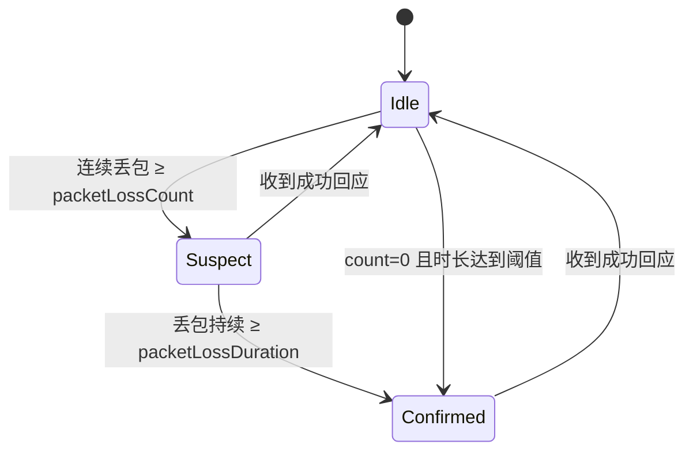

# 多协议探测改造计划（ICMP / TCP / UDP / HTTP）

> 状态：**已实施**。P0~P7 全部完成，本文档保留为设计依据与决策记录。
> 关联文档：[DEVELOPMENT](DEVELOPMENT.md)、[README](../README.md)。

## 0. 最终决策（实施时确定）

| 待定项 | 结论 |
|--------|------|
| HTTP 计时口径 | **默认每轮新建连接**（`reuseConnection` 默认 `false`），保证 RTT 与 ping 可比 |
| UDP 判定范围 | **只做「回声服务 + 端口不可达」**，不提供「只发不收」模式（无法产生有意义的丢包语义） |
| 丢包告警 | **AND 改为两级升级**：先按次数给 Warning（疑似），再按时长给 Critical（确认） |
| p95 / 标准差 | **不进实时表格**，仅在快照 / 通知模板 / verbose 日志中提供 |
| `ip` 字段 | **直接改名为 `target`**，不做兼容；`target` 同时承载 host（icmp/tcp/udp）与完整 URL（http），不再单独设 `url` 字段 |

实施中与下文设计有出入的地方：

- 窗口统计改为 `Snapshot()` 单遍扫描，不做增量聚合（回绕扣减容易漂移，扫描成本可忽略）。
- 超限的延迟样本不参与 SRTT / RTTVAR 基线更新，否则一次尖峰会把 RTTVAR 撑大，
  紧随其后的同样高的样本立刻变得「正常」，连续确认永远凑不满。
- 枚举中去掉 `Canceled`：取消统一用 `OperationCanceledException` 表达，避免与超时状态混淆。
- 硬故障（端口关闭 / DNS / TLS / 状态码）按 `ProbeSeverity` 直接给出 Warning / Critical 状态事件，
  不再单独设一类事件。

## 1. 现状（改造前）

### 1.1 只有 ICMP

全仓库唯一的探测路径是 `IcmpTestTask.ProbeAsync` 里的 `Ping.SendPingAsync`。`NotificationService` 里的 `HttpClient` 只用于发 webhook，不是探测；`AppConfig` 里唯一的 `port` 是 SMTP 端口。

### 1.2 协议耦合点

| 位置 | 耦合内容 | 处理方式 |
|------|----------|----------|
| `Monitoring/IcmpTestTask.cs` | 循环、状态机、统计、`Ping` I/O 混在一个类 | 拆成 `ProbeTask`（编排）+ `ProbeStateMachine`（纯逻辑）+ `IProbeTransport`（I/O） |
| `Monitoring/IcmpTaskSnapshot.cs` | 字段类型是 `IPStatus`，只有 ICMP 语义 | 改成 `ProbeStatus`，`IPStatus` 只出现在 ICMP transport 内部 |
| `Monitoring/IPStatusExtensions.cs` | 故障分类直接基于 `IPStatus` | 分类移到 `ProbeStatus`，ICMP 只负责 `IPStatus → ProbeStatus` 映射 |
| `Monitoring/IcmpTaskOptions.cs` | 目标只有 host，没有协议/端口/URL | 增加 `Protocol`、`Port`、`Url`、HTTP/UDP 参数 |
| `Configuration/AppConfig.cs` | `IcmpTaskConfigJson` 无协议字段 | 增加 `protocol`、`port`、`url` 等，保持 `ip` 兼容 |
| `Configuration/ConfigValidator.cs` | 只校验 IP/主机名 | 按协议分支校验（见 2.5） |
| `Ui/MonitorView.cs` | 目标列只显示 host | 目标列显示 `Endpoint`（含 scheme/端口），列结构不变 |
| `Program.cs` | `IcmpTaskOptions.FromJson` 直接构造 ICMP 任务 | 改为工厂按 `protocol` 选择 transport |
| `tests/Pings.Tests/*` | 断言用 `IPStatus` / `Icmp*` | 跟随重命名，新增状态机测试 |

### 1.3 现有统计与告警的实际缺陷

| # | 问题 | 位置 | 影响 |
|---|------|------|------|
| 1 | 丢包告警双阈值是 **AND**：`count=5, duration=30` 时，即使 1 秒 1 次探测已经连续丢 5 次，也要等满 30 秒才告警 | `IcmpTestTask.ShouldRaiseLossAlarm` | 默认配置下告警延迟被时长阈值主导，次数阈值形同虚设 |
| 2 | 状态事件按原始 `IPStatus` 变化触发，但告警去重按 `Category` | `ApplyResult` vs `IcmpMonitor.OnStatusChanged` | `TimedOut ↔ Unknown` 这类同类别抖动会刷日志、反复触发事件，却不产生新告警 |
| 3 | `_lastEvent` 先写丢包告警文案，随后被 `statusChanged` 分支覆盖 | `ApplyResult` 中赋值顺序 | 首次丢包同时满足次数阈值时，事件快照里的文案是“请求超时”，丢包文案与时长丢失 |
| 4 | 延迟波动只与“上一次探测”比较；任何一次失败会把 `_lastDelayMs` 置空，波动基线被清掉 | `ApplyResult` | 单次抖动/单次失败即可造成误报或漏报，慢升高的延迟永远不告警 |
| 5 | 丢包时长用 `DateTimeOffset.Now` 计算 | `_lossEpisodeStart` | 系统校时/夏令时可导致时长跳变甚至为负 |
| 6 | `IcmpStatistics` 已算出 `Min/Avg/Max/Last/Lost`，但 `BuildSnapshot` 全部丢弃 | `IcmpTestTask.BuildSnapshot`、`IcmpTaskSnapshot` | UI 只有当前延迟与抖动，README 宣称的统计能力并未真正呈现 |
| 7 | 抖动用 `double` 而非 `double?`，0 时 UI 显示 `-` | `IcmpTaskSnapshot.JitterText`、`MonitorView.FormatDelay` | 无法区分“极其稳定（0ms）”与“样本不足” |
| 8 | 无 p95、无标准差 | `IcmpStatistics` | 平均值掩盖长尾，无法判断“偶发尖峰” |
| 9 | 每次成功探测都把所有非成功状态计为丢包，包括 DNS 失败、TLS 失败、端口拒绝 | `Record(status == Success, …)` | 服务不可用会被当成网络丢包并进入丢包升级流程，误导定位 |
| 10 | 通知冷却键只用 `Target`，且字典无上限 | `IcmpMonitor.TryEnterNotificationWindow` | 同一主机的不同端口/协议共用冷却；长期运行字典只增不减 |
| 11 | `WarningQueue` 满 32 条时静默丢弃最旧，且不去重 | `WarningQueue.Enqueue` | 用户看到的告警可能缺失，且同一故障反复入队 |
| 12 | `Snapshot()` 每次全窗扫描，事件路径与 UI 刷新路径各扫一次 | `IcmpStatistics.Snapshot` | 窗口 255 时无感，但 `maxRecentPackets` 上限允许 100000 |
| 13 | `DEVELOPMENT.md` 声称“间隔小于超时”会给出配置警告，实际未实现 | `ConfigValidator.ValidateTasks` | 文档与行为不一致 |
| 14 | `--once` 用 `Category != None` 判定不可达，但 `IPStatus.Unknown` 也会归入 `Unknown` 分类 | `Program.RunOnceAsync` | 单次探测的偶发异常直接让 CI 返回 4 |

## 2. 目标模型

### 2.1 协议与状态枚举

```csharp
public enum ProbeProtocol { Icmp, Tcp, Udp, Http }

public enum ProbeStatus
{
    Unknown,            // 尚未探测
    Success,
    Timeout,            // 没有任何回应：ICMP 超时 / TCP 连接超时 / HTTP 连接超时
    NoReply,            // 已发出报文但对端无应用层回应（UDP 未收到 echo）
    Unreachable,        // 收到明确的失败回应：ICMP unreachable / 目标禁止 / TTL 过期
    PortClosed,         // TCP RST 或 UDP 收到端口不可达，主机可达、服务不可用
    DnsFailure,
    TlsFailure,
    HttpStatusUnexpected,
    ResponseTimeout,    // 连接已建立，但响应阶段超时
    ProtocolError,      // 报文格式异常
    LocalError          // 本机权限 / 套接字资源不足
    // 取消不用状态表达：一律抛 OperationCanceledException，避免与超时混淆
}
```

每个状态派生三个事实，避免调用方各自 switch：

```csharp
public static class ProbeStatusFacts
{
    public static bool IsSuccess(this ProbeStatus status) => status == ProbeStatus.Success;

    /// <summary>“丢包”只统计完全没有任何回应的情况。</summary>
    public static bool CountsAsLoss(this ProbeStatus status)
        => status is ProbeStatus.Timeout or ProbeStatus.NoReply;

    /// <summary>所有非成功都算一次故障，但未必算丢包。</summary>
    public static bool IsFailure(this ProbeStatus status)
        => status is not (ProbeStatus.Success or ProbeStatus.Unknown);

    // 中断升级另有一套更宽的口径（含 Unreachable / ResponseTimeout），
    // 以及「主机已给出回应」的判定（EndsOutage），见 ProbeStatusFacts。

    public static ProbeFaultCategory Category(this ProbeStatus status) => status switch
    {
        ProbeStatus.Success => ProbeFaultCategory.None,
        // Unreachable 与超时同属 NoResponse：设备离线时两者会随 ARP 状态每几秒翻转，
        // 是同一个故障的两个观测面，拆成两类会让日志被刷满（见 4.4）。
        ProbeStatus.Timeout or ProbeStatus.NoReply or ProbeStatus.ResponseTimeout or ProbeStatus.Unreachable => ProbeFaultCategory.NoResponse,
        ProbeStatus.PortClosed or ProbeStatus.HttpStatusUnexpected or ProbeStatus.TlsFailure => ProbeFaultCategory.ServiceUnavailable,
        ProbeStatus.DnsFailure => ProbeFaultCategory.NameResolution,
        ProbeStatus.ProtocolError => ProbeFaultCategory.ProtocolError,
        ProbeStatus.LocalError => ProbeFaultCategory.LocalResource,
        _ => ProbeFaultCategory.Unknown
    };
}
```

语义约定（需要写进 README）：

- **丢包率** = `CountsAsLoss` 的样本 / 有效样本，表示“完全没收到回应”。
- **故障率** = `IsFailure` 的样本 / 有效样本，包含端口拒绝、DNS 失败、HTTP 状态错误等。
- 端口拒绝、DNS 失败、TLS 失败属于“主机可达或探测未发出”，不计入丢包率，但会立刻触发状态告警。

### 2.2 单次探测结果

```csharp
public readonly record struct ProbeResult(
    ProbeStatus Status,
    double? RttMs,
    string? Detail,
    double? ConnectMs = null);
```

`Detail` 保留协议特有的原始信息（例如 `IPStatus.DestinationHostUnreachable` 的中文描述、`SocketError` 文本、HTTP 状态码），界面优先显示 `Detail`，为空时回退到状态的通用中文描述。

### 2.3 传输层抽象

```csharp
internal interface IProbeTransport : IAsyncDisposable
{
    ValueTask<ProbeResult> ProbeAsync(CancellationToken token);
}
```

| 协议 | 成功判定 | 失败映射 | 关键实现点 |
|------|----------|----------|------------|
| ICMP | `PingReply.Status == Success` | `IPStatus` → `Timeout` / `Unreachable` / `ProtocolError` / `LocalError` | 复用现有 `Ping` 实例；`PingOptions` 支持 TTL / 不分片 / 负载大小 |
| TCP | `TcpClient.ConnectAsync` 完成 | 连接超时 → `Timeout`；`ConnectionRefused` → `PortClosed`；DNS/套接字错误 → `DnsFailure` / `LocalError` | 只测建连，不发送业务数据；超时用 linked CTS，区分外部取消与超时 |
| UDP | 收到应用层回声 | 超时 → `NoReply`；`ConnectionRefused`/`ConnectionReset` → `PortClosed`；其余 → `LocalError` | connected socket + `ReceiveAsync`；`udpExpectReply=false` 时只测发送路径，结果标记为 `NoReply` 且不计告警 |
| HTTP(S) | 状态码在期望集合内 | 建连超时 → `Timeout`；响应超时 → `ResponseTimeout`；TLS → `TlsFailure`；状态码不符 → `HttpStatusUnexpected` | `SocketsHttpHandler` + `ConnectTimeout`；默认每轮新建连接，保证 RTT 可比 |

UDP 的语义必须显式写清楚：UDP 没有握手，**没有回声服务时无法区分“主机不可达”和“服务不响应”**。因此：

- 默认 `udpExpectReply = true`，探测包默认 32 字节文本 `Pings`；
- 收到 ICMP 端口不可达（Windows/Linux 的 connected UDP 都会以 `ConnectionRefused`/`ConnectionReset` 暴露）时，判定为主机可达、端口关闭，属于成功的安全信号，不报警；
- 只有配置了回声服务（如自建 echo、NTP 之外的私有服务）才能得到有意义的 RTT；
- 无回声服务且需要连通性判断时，建议改用 TCP 端口探测。文档中给出这个建议，而不是假装 UDP 能测延迟。

HTTP 的计时口径：

- 默认 `reuseConnection = false`，设置 `PooledConnectionLifetime = TimeSpan.Zero` 并加 `Connection: close`，每轮都重新走 DNS + TCP + TLS，得到与 ping 可比的端到端 RTT；
- `reuseConnection = true` 时保留连接池，测量的是应用层往返，适合观察服务处理时间，两种口径不能混在同一张表里比较；
- 默认 `useProxy = false`，避免系统代理把 RTT 变成代理的 RTT；
- 默认 `followRedirects = false`，3xx 计为成功但记录 `Detail`，避免把跳转链路的耗时算进目标。

### 2.4 配置模型

扩展 `ProbeTaskConfigJson`（`ip` 已改名为 `target`，无兼容层）：

```jsonc
{
  "tasks": [
    {
      "name": "网关",
      "protocol": "icmp",
      "target": "192.168.1.1"
    },
    {
      "name": "数据库",
      "protocol": "tcp",
      "target": "10.0.0.5",
      "port": 5432
    },
    {
      "name": "DNS 服务",
      "protocol": "udp",
      "target": "10.0.0.53",
      "port": 5353,
      "udpPayload": "Pings"
    },
    {
      "name": "健康检查",
      "protocol": "http",
      "target": "https://api.example.com/health",
      "httpMethod": "HEAD",
      "expectedStatus": [200, 204]
    }
  ]
}
```

| 字段 | 适用协议 | 默认值 | 说明 |
|------|----------|--------|------|
| `protocol` | 全部 | `icmp` | `icmp` / `tcp` / `udp` / `http`，大小写不敏感 |
| `target` | 全部 | 必填 | icmp / tcp / udp 为主机名或 IP；http 为完整 URL |
| `port` | tcp / udp | 必填 | 1~65535 |
| `httpMethod` | http | `HEAD` | 仅允许 `HEAD` / `GET`，405 时自动回退到 GET |
| `expectedStatus` | http | 空 | 空表示 200~399；配置后必须精确匹配 |
| `followRedirects` | http | `false` | 是否跟随 3xx |
| `reuseConnection` | http | `false` | 是否复用连接池 |
| `useProxy` | http | `false` | 是否使用系统代理 |
| `udpPayload` | udp | `Pings` | 发送的文本负载 |
| `payloadSize` | icmp | `32` | 探测负载字节数 |
| `lossFlapWindowSeconds` | 全部 | `300` | 短故障统计窗口（秒） |
| `lossFlapCount` | 全部 | `3` | 窗口内短故障达到多少次判定为抖动链路 |

任务去重键从 `Target` 改为 `Protocol + Endpoint`（例如 `tcp://10.0.0.5:5432`），名称重复的警告逻辑不变。

### 2.5 校验矩阵

| 条件 | 级别 | 文案方向 |
|------|------|----------|
| `protocol` 不在枚举内 | 错误 | 列出允许值 |
| icmp 的 `ip` 非法 | 错误 | 保持现状 |
| icmp 配置了 `port` / `url` | 警告 | 字段被忽略 |
| tcp/udp 缺少 `port` 或端口越界 | 错误 | 1~65535 |
| tcp/udp 的 `ip` 非法 | 错误 | 同 icmp |
| udp 的 `udpPayload` 超过 65507 字节 | 错误 | UDP 负载上限 |
| http 缺少 `url` 或 URL 非 http/https | 错误 | 绝对地址 |
| http 同时配置 `ip` 且与 URL 主机不一致 | 警告 | 以 `url` 为准 |
| http 的 `httpMethod` 不在白名单 | 错误 | 只允许 HEAD/GET |
| `expectedStatus` 含非法状态码 | 错误 | 100~599 |
| `interval < timeout` | 警告 | 实际间隔会被探测耗时撑大（补上 DEVELOPMENT 已声明的校验） |
| 丢包双阈值都为 0 | 警告 | 保持现状 |

> 实施时补充：`udpPayload` 为空、`lossFlapWindowSeconds` / `lossFlapCount` 越界均报错；
> 同主机不同协议 / 端口不算重复端点。

## 3. 统计算法

### 3.1 采样模型

```csharp
private readonly record struct ProbeSample(bool Success, bool Loss, double RttMs);
```

- `Success`：计入接收数与 RTT 统计；
- `Loss`：计入丢包率（仅 `Timeout` / `NoReply`）；
- 其余失败：计入故障率，不计入丢包率，不产生 RTT 样本；
- `Unknown`（首次探测前）：整条样本不入统计。

### 3.2 窗口与聚合

- 环形缓冲区保存最近 `maxRecentPackets` 条样本；
- `Sent` / `Received` / `Lost` / `Failed` 增量维护；窗口内的均值 / 极值 / 方差 / 分位数在 `Snapshot()` 时单遍扫描完成
  （窗口回绕时扣减聚合量容易漂移，扫描成本可忽略）；
- 标准差使用 `sqrt(max(0, sumSq / n - mean²))`，`max(0, …)` 防止浮点相消出现负零；
- p95 使用排序法：窗口成功样本 ≤ 4096 时全量排序，超过时按固定步长抽样到 4096 个再排序，文档标注为近似值。

### 3.3 RTT 统计

快照新增：`MinRttMs`、`AverageRttMs`、`MaxRttMs`、`P95RttMs`、`LastRttMs`、`StdDevMs`、`WindowReceived`、`WindowCount`、`Lost`、`Failed`。

- 极值/均值/分位数只统计窗口内的成功样本；
- `LastRttMs` 保留最近一次成功 RTT，跨丢包保留，不因失败清零；
- 空窗口时全部为 null，界面显示 `-`，与“0ms”区分。

### 3.4 抖动

保留 RFC 3550 风格 EWMA（增益 1/16），但修正语义：

- `JitterMs` 改为 `double?`，样本数 < 2 时为 null；
- 新增 `JitterSamples`，界面只在 ≥ 2 时显示 `±x.xms`；
- 抖动只在连续成功样本间更新，跨丢包时重新起算（`_lastRttMs = null`），避免把丢包前后的 RTT 差当作抖动；
- 不把 EWMA 抖动用于告警，只作为展示与趋势参考。

### 3.5 延迟基线（SRTT / RTTVAR）

延迟波动从“与上一次比较”换成 RFC 6298 风格的双 EWMA 基线：

```text
首次成功：SRTT = R，RTTVAR = R / 2
后续成功：
    RTTVAR = (1 - β) * RTTVAR + β * |SRTT_old - R|
    SRTT   = (1 - α) * SRTT_old + α * R
    α = 1/8，β = 1/4
```

- 波动阈值：`limit = max(significantDelayThreshold, 4 * RTTVAR)`；
- 触发条件：`R > SRTT_old + limit`，且已累计至少 5 个成功样本（预热期不告警）；
- 连续确认：`spikeConfirmSamples`（默认 2）个连续样本超限才触发，单个毛刺不告警；
- 施密特回差：触发后进入 `spikeActive`，只有 `R ≤ SRTT + limit / 2` 才解除，避免在阈值附近反复触发；
- 基线在丢包期间保持不变，恢复后继续使用旧基线，避免“停一次就忘记历史”；
- 顺序必须是“先判定、后更新 SRTT/RTTVAR”，否则拿新基线跟新样本比较，永远不会触发；
- **超限样本不参与基线更新**：否则一次尖峰把 RTTVAR 撑大后，紧随其后的同样高的样本会立刻落回阈值内，
  连续确认永远凑不满；
- 恢复当次不判波动（`allowSpike = previousCategory == None`）：基线已过期，报出来的「升高」没有意义。

### 3.6 快照字段

```csharp
public sealed record ProbeTaskSnapshot(
    string Name,
    ProbeProtocol Protocol,
    string Endpoint,          // 显示用：icmp://host、tcp://host:port、https://host/path
    ProbeStatus Status,
    ProbeFaultCategory Category,
    ProbeSeverity Severity,
    double? DelayMs,
    double? JitterMs,
    int JitterSamples,
    double? MinRttMs, double? AverageRttMs, double? MaxRttMs, double? P95RttMs, double? StdDevMs,
    double WindowLossRate, double TotalLossRate, double TotalFailureRate,
    long Sent, long Received, long Lost, long Failed,
    int WindowCount,
    double EpisodeSeconds,
    DateTimeOffset Timestamp,
    string LastEvent,
    string? Warning,
    int WarningCount,
    int DroppedWarnings);
```

`StatusText` 优先使用 `LastDetail`（协议原始描述），`Endpoint` 由 `ProbeTaskOptions` 统一生成，UI 不再自己拼字符串。

## 4. 告警算法

### 4.1 丢包升级状态机

把双阈值的 AND 改成两级升级，解决默认配置下告警过慢的问题：



- `Suspect`：发 `Warning` 级事件（入告警队列、按冷却发通知）；
- `Confirmed`：发 `Critical` 级事件（必发通知，不受 `Warning` 去重抑制）；
- 两个阈值都配置时不再要求同时满足，而是先后升级；只配置一个时按该阈值直接触发；
- 两个都为 0 时完全不触发（保持现状，校验仍给警告）；
- 一个 episode 内每个级别只触发一次，成功回应后重置；
- 时长使用 `TimeProvider.GetTimestamp()` 单调时钟，展示用的 `DateTimeOffset` 只用于文案。

### 4.2 硬故障分类告警

- `PortClosed`、`DnsFailure`、`TlsFailure`、`HttpStatusUnexpected` 不进入丢包 episode；
- 它们按 `Category` 变化触发一次 `StateChanged`，并立即产生 `Warning`（`DnsFailure`/`TlsFailure`）或 `Critical`（`PortClosed`/`HttpStatusUnexpected`）事件；
- 同一类别持续存在时不重复告警；类别变化（例如 `PortClosed → Timeout`）才算新事件。

### 4.3 短故障（抖动链路）检测

只靠 `packetLossDuration` 会漏掉“每次断 10 秒、两分钟一次”的不稳定链路。增加 episode 频率判定：

- episode 在进入 `Confirmed` 之前就恢复，记为一次 `ShortEpisode`；
- 记录最近 `lossFlapWindowSeconds`（默认 300）内的 `ShortEpisode` 时间戳；
- 达到 `lossFlapCount`（默认 3）次时产生一次 `Flapping` 告警（同一窗口内只触发一次）；
- 该阈值默认开启，设为 0 可关闭。

### 4.4 事件与去重

- `StateChanged` 只在 **`ProbeFaultCategory` 变化**时触发，不再按原始 `ProbeStatus` 触发；
- `NoResponse` 统括「目标整体没响应」的多种表现（`Timeout` / `NoReply` / `ResponseTimeout` / `Unreachable`）：设备离线时 ARP 缓存在「有旧条目」与「重新解析失败」之间翻转，会表现为 `请求超时 ↔ 目标主机不可达`，那是同一故障的两个观测面；
- 类别不变、只是 `ProbeStatus` 变了时产生 `StatusDetail`（`Info` 级）明细事件，默认不写日志，`--verbose` 时输出；
- `LastEvent` 的更新优先级：`Critical` > `Warning` > 状态变化 > 延迟波动 > 普通成功，低优先级不得覆盖高优先级（修复第 1.3 节第 3 条）；
- 同一故障类别内的连续变化只更新 `Detail` 文本与快照，不产生状态事件、不入告警队列；
- 恢复（`Group` 变为 `None`）单独触发一次恢复事件，受 `notifyOnRecovery` 控制。

### 4.5 通知冷却与告警队列

- 冷却键从 `Target` 改为任务标识 `Name|Protocol|Endpoint`，避免同主机的不同服务互相压制；
- 冷却字典在条目超过 1024 时清理 24 小时前的记录，防止长期运行无界增长；
- `Critical` 事件不受冷却限制（故障确认必须送达），`Warning` 受冷却限制；
- `WarningQueue` 增加：
  - 相邻重复消息去重（相同文本只保留一条，计数 +1）；
  - `Dropped` 计数，容量溢出时递增并在 caption 中提示；
  - `Count` 仍表示去重后的条数。

### 4.6 文案与时间

- 时长、间隔一律使用单调时钟，`DateTimeOffset.Now` 只用于展示时间戳；
- 告警文案保持“短文本 + 时分秒”的既有约束（`请求超时 11:02:15`），不引入日期；
- 丢包告警文案补充级别与累计时长，例如 `连续无响应 5 次 / 12s`、`连续无响应 30s 已确认`；
- 端口关闭区分于超时：`端口关闭 11:02:15` 不再显示为“请求超时”。

## 5. 阶段计划

| 阶段 | 内容 | 验收标准 | 主要文件 |
|------|------|----------|----------|
| P0 | 基线保护 | 先补 `ProbeTask` 缺失的测试：用假 transport 覆盖成功/超时/恢复/告警，记录当前 `--once` 输出作为黄金样例 | `tests/Pings.Tests/ProbeTaskTests.cs` |
| P1 | 模型抽取（纯重命名，不改行为） | 编译器驱动的全量改名；ICMP 行为、日志文案、表格输出与改造前逐字节一致 | `Monitoring/*`、`Configuration/*`、`Ui/*`、`Program.cs` |
| P2 | 统计升级 | 新增 p95/标准差/故障率/空值语义；旧测试改为新 API；新增窗口回绕、混合失败、分位数测试 | `ProbeStatistics.cs`、`ProbeTaskSnapshot.cs`、`MonitorView.cs` |
| P3 | 告警状态机 | 状态机抽成纯类，注入 `TimeProvider`；补两阈值升级、短故障、施密特回差、事件去重测试 | `ProbeStateMachine.cs`、`ProbeMonitor.cs`、`WarningQueue.cs` |
| P4 | TCP | loopback 监听器测试成功；关闭端口测试 `PortClosed`；不可路由地址测试 `Timeout`；配置校验与文档同步 | `Transports/TcpProbeTransport.cs` |
| P5 | HTTP(S) | 本地 `HttpListener` 测试 2xx/4xx/超时；验证新建连接与复用连接两种口径；TLS 失败映射 | `Transports/HttpProbeTransport.cs` |
| P6 | UDP | 本地 UDP 回声服务测试成功/RTT；无监听端口测试 `PortClosed`；无回声测试 `NoReply`；文档写清语义边界 | `Transports/UdpProbeTransport.cs` |
| P7 | 收尾 | 更新 README/DEVELOPMENT/示例配置；AOT 发布冒烟；清理旧类型、旧常量、旧测试路径 | 全部 |

建议顺序说明：P2/P3 与协议无关，可以先落地；若先做 P4~P6，统计与告警要写两遍，反而增加返工。

## 6. 测试计划

- **状态机（纯逻辑，无网络）**：使用自定义 `TimeProvider` 推进时间，覆盖 4.1~4.4 的每条转移；重点断言“5 次连续丢包在第 5 次触发 `Suspect`，第 30 秒触发 `Confirmed`”，以及短故障计数在窗口内外的行为。
- **统计**：窗口回绕、混入 `PortClosed`/`DnsFailure` 时丢包率不变而故障率上升、p95 抽样上限、抖动样本不足返回 null、`Reset()` 归零。
- **传输层**：
  - TCP：`TcpListener` 本机随机端口接受连接；关闭的端口；`10.255.255.1` 之类不可路由地址（超时可能受宿主环境影响，测试里把超时压到 200ms 并用 `Skip` 兜底）；
  - UDP：本机 `UdpClient` 回声；无监听端口；`udpExpectReply=false`；
  - HTTP：`HttpListener` 返回 200/204/404/延迟响应；TLS 用自签证书验证 `TlsFailure`（或直接断言握手异常映射，不校验证书链细节）；
  - ICMP：保持现有 `8.8.8.8` 之外的单元测试不触网，集成测试单独标记。
- **配置**：校验矩阵逐行一条测试，含旧配置（无 `protocol`）默认走 icmp。
- **UI/布局**：`Endpoint` 长文本在窄窗口下仍被 `Ellipsis` 截断；列集合不变，阈值不需重算。
- **AOT**：`dotnet publish` 后对 loopback TCP/HTTP 执行 `--once`，确认无反射裁剪问题（`SocketsHttpHandler` 与源生成 JSON 均可 AOT）。

## 7. 兼容性与风险

| 风险 | 说明 | 对策 |
|------|------|------|
| 告警语义变化 | 双阈值从 AND 改为两级升级，默认配置下告警会提前 | 作为行为变更写进 release notes；新增 `lossAlarmMode` 不值得，保持单一语义 |
| 丢包率口径变化 | 端口拒绝/DNS/TLS 不再计入丢包率 | 新增故障率列/字段，README 明确定义 |
| UDP 语义不可靠 | 无回声服务时 `NoReply` 无法区分主机不可达与服务不响应 | 默认 `udpExpectReply=true`，文档建议连通性检测优先用 TCP |
| HTTP 计时口径 | 复用连接与新建连接的 RTT 不可比 | 默认不复用，配置项显式选择，表格中标注协议与端口 |
| Windows/Linux 差异 | connected UDP 的 ICMP 错误暴露行为、ICMP 权限 | 传输层按 `SocketError` 映射，集成测试按平台 `Skip` |
| 重命名波及面大 | 类型/文件/测试全量改名容易夹带逻辑改动 | P1 只做机械重命名，行为测试先行 |
| 长窗口性能 | `maxRecentPackets` 上限 100000 | 增量聚合 + p95 抽样上限；必要时把上限降到 10000 并给迁移提示 |

## 8. 待确认项

全部已确认，结论见第 0 节。
